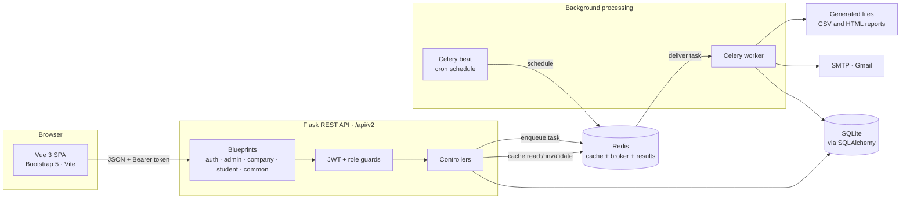
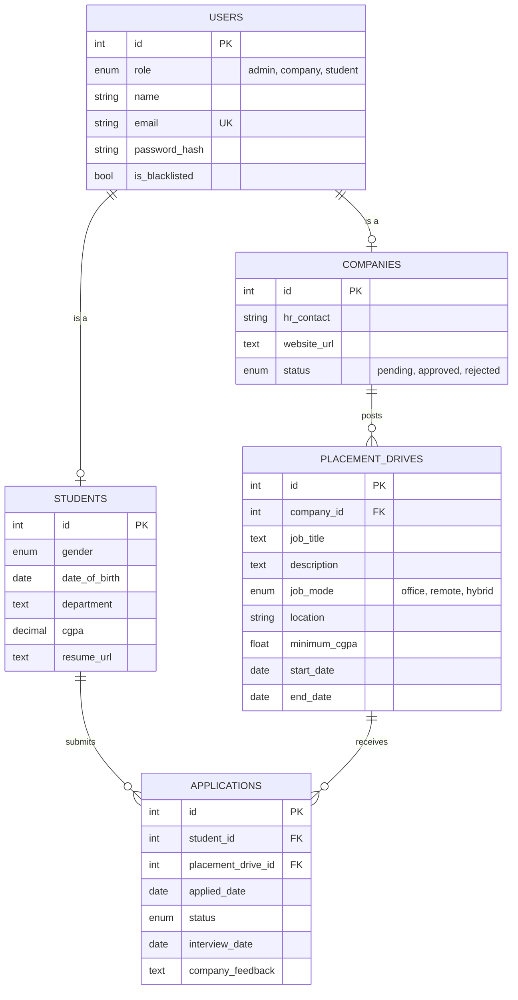
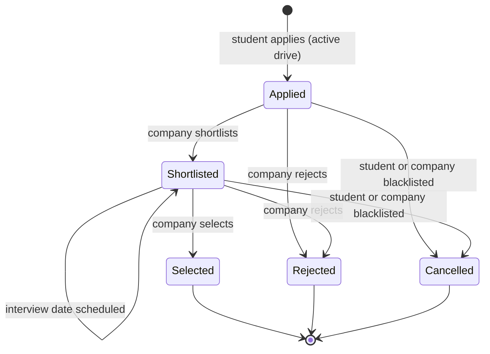

<div align="center">

# 🎓 Placement Portal Application

**A full-stack campus placement platform where companies post drives, students apply, and administrators manage the process.**

Flask REST API · Vue 3 SPA · JWT role-based access · Redis caching · Celery background and scheduled jobs


[Features](#-features) · [Architecture](#-architecture) · [Quick Start](#-quick-start) · [API](#-api-overview) · [Design Decisions](#-design-decisions) · [Limitations](#️-known-limitations)

</div>

---

## 📌 Overview

This project helps manage campus placements. Students can find and apply for suitable job drives, companies can manage applicants, and administrators can approve companies and manage the platform.

It is version 2 of the Placement Portal, **built for the IIT Madras BS in Data Science and Applications course, Modern Application Development II (MAD-II)**. The backend uses Flask, the frontend uses Vue, and Redis with Celery handles background tasks such as exports and scheduled emails. The full write-up is in [`project_report.pdf`](project_report.pdf).

| | |
|---|---|
| **Roles** | Admin, Company and Student, each with its own dashboard and permissions |
| **Backend** | ~1,230 lines of Python, 28 REST endpoints and 5 tables |
| **Frontend** | ~1,870 lines of Vue 3 across 3 dashboards and 3 auth pages |
| **Async work** | 2 scheduled jobs (daily and monthly) and 2 on-demand CSV exports |
| **History** | 34 commits using [Conventional Commits](https://www.conventionalcommits.org/) |

## ✨ Features

### 👤 By role

| Role | What they can do |
|---|---|
| **🛡 Admin** | View platform stats; approve or reject companies; blacklist or unblacklist companies and students; view students, drives and applications; close drives; search companies and students by ID or name |
| **🏢 Company** | Register and await approval; create drives; review applicants; shortlist, schedule interviews, select or reject candidates; view student profiles; export applications to CSV |
| **🎓 Student** | Register with academic details; browse approved companies and drives; see UI eligibility; apply once per drive; track status; update profile details; export application history to CSV |

### ⚙️ Platform capabilities

| Capability | How it works |
|---|---|
| **Approval workflow** | Companies start as `pending`. Login is blocked until an admin approves them. |
| **Blacklisting with side-effects** | Blacklisting a student cancels open applications. Blacklisting a company closes its drives and cancels open applications. |
| **Role-based access control** | JWT identifies the user; blueprint-level guards enforce role and blacklist checks before protected routes run. |
| **Redis caching** | Frequently read lists are cached for five minutes. Relevant write paths explicitly invalidate their matching cache keys. |
| **Async CSV export** | A Celery task generates the CSV. The API returns `202` and a task ID immediately; the UI polls for completion. |
| **Scheduled jobs** | Daily interview reminders and monthly company reports run through Celery Beat. |

## 🏗 Architecture



### Data model



`USERS` stores identity and credentials for every role. `COMPANIES` and `STUDENTS` share the user's primary key, keeping role-specific data separate from authentication data. ORM relationships cascade when a user is deleted.

### Application lifecycle



## 🧰 Tech Stack

| Layer | Technology | Used for |
|---|---|---|
| Frontend | Vue 3 (Options API), Vite 8, Bootstrap 5 | Component-based SPA with a hash router |
| API | Flask 3.1, Blueprints | Modular REST API under `/api/v2` |
| Auth | Flask-JWT-Extended, Flask-Bcrypt | Token auth, password hashing and role checks |
| Database | SQLite, Flask-SQLAlchemy, SQLAlchemy 2 | ORM models, relationships and application-model enums |
| Cache | Redis, Flask-Caching | Response caching with explicit invalidation |
| Jobs | Celery 5.6, Redis | CSV exports, reminders and reports |
| Email | Flask-Mail (SMTP) | Interview reminders and monthly reports |

## 🚀 Quick Start

**Prerequisites:** Python 3.12, Node.js `^22.18` or `>=24.12`, and a running Redis server.

### 1. Clone and install

```bash
git clone https://github.com/devnischandra/placement-portal-application.git
cd placement-portal-application

python -m venv venv
source venv/bin/activate          # Windows: venv\Scripts\activate
pip install -r requirements.txt

cd frontend && npm install && cd ..
```

### 2. Configure environment

Create `.env` in the repository root:

```env
JWT_SECRET_KEY=replace-with-a-long-random-string
ADMIN_EMAIL=admin@example.com
ADMIN_PASSWORD=choose-a-strong-password

# Needed only for email features.
MAIL_USERNAME=your-address@gmail.com
MAIL_PASSWORD=your-gmail-app-password
```

| Variable | Required | Purpose |
|---|:-:|---|
| `JWT_SECRET_KEY` | ✅ | Signs access tokens |
| `ADMIN_EMAIL`, `ADMIN_PASSWORD` | ✅ | Seeds the admin account on first start |
| `MAIL_USERNAME`, `MAIL_PASSWORD` | Email only | Gmail SMTP credentials |
| `SQLALCHEMY_DATABASE_URI` | Optional | Defaults to a local SQLite database |
| `REDIS_URL` | Optional | Defaults to `redis://127.0.0.1:6379/0` |

> `.env` is already ignored by Git. Never commit it.

### 3. Run the services

Run these in separate terminals from the repository root:

```bash
# Redis
redis-server

# API
cd backend && python app.py

# Celery worker (Windows: add -P solo)
cd backend && celery -A celery_app.celery worker --loglevel=info

# Celery Beat (optional for local development)
cd backend && celery -A celery_app.celery beat --loglevel=info

# Frontend
cd frontend && npm run dev
```

Open `http://127.0.0.1:5173`. Register a company, approve it as admin, create a drive, register a student, apply, and then process the application as the company.

## 🔌 API Overview

All API routes below live under `/api/v2`. Protected groups require `Authorization: Bearer <token>`.

| Group | Routes |
|---|---|
| **Auth** | `POST /auth/tokens`, `POST /auth/companies`, `POST /auth/students`, `GET /auth/me` |
| **Admin** | Stats, companies, students, users, placement drives and applications under `/admin/...` |
| **Company** | Placement drives, applications, student profiles and CSV export under `/company/...` |
| **Student** | Profile, companies, drives, applications and CSV export under `/student/...` |
| **Common** | `GET /common/celery-task-status/{task_id}` |

See the route modules in [`backend/api/routes`](backend/api/routes) for the complete endpoint and method list.

## 📁 Project Structure

```text
placement-portal-application/
├── backend/
│   ├── app.py                 # App setup, config and admin seeding
│   ├── extensions.py          # Shared Flask extensions
│   ├── models.py              # SQLAlchemy models and enums
│   ├── celery_app.py          # Celery instance and Beat schedule
│   ├── api/
│   │   ├── guards.py          # Role guards
│   │   ├── routes/            # Blueprints
│   │   └── controllers/       # Business logic and validation
│   └── tasks/                 # CSV exports, reminders and reports
├── frontend/src/
│   ├── apiRequest.js          # Fetch wrapper with JWT handling
│   ├── Router.vue             # Hash-based router
│   ├── components/            # Reusable Base* components
│   └── pages/                 # Auth and dashboard pages
├── requirements.txt
└── project_report.pdf
```

## 🧠 Design Decisions

- **Thin routes, focused controllers.** Blueprints map URLs to controller functions, keeping business rules in one place.
- **Authorization at the blueprint boundary.** Role guards run before protected route handlers.
- **Shared extensions module.** Database, JWT, cache and mail extensions are initialized without circular imports.
- **Shared-primary-key profiles.** `Company.id` and `Student.id` are foreign keys to `users.id`, enforcing one profile per user.
- **Date-derived drive closure.** A drive is active only when today falls between its start and end dates; closing a drive moves its end date to yesterday.
- **Asynchronous slow work.** Exports return `202` and a task ID; Celery handles exports and scheduled email work outside requests.
- **API validation.** Drive creation validates dates, ordering, mode and minimum CGPA; relevant updates validate statuses and dates.

## ⚠️ Known Limitations

- **No automated tests.** The application is currently verified manually.
- **Development configuration.** The API URL is hard-coded to `127.0.0.1:5000`, Flask runs in debug mode, and the token is stored in `localStorage`.
- **SQLite and no migrations.** Appropriate for a course project, but not for concurrent production use.
- **No pagination** on list endpoints.

## 👤 Author

**Nishant Chandra**, BS in Data Science and Applications, IIT Madras · [@devnischandra](https://github.com/devnischandra)

<div align="center">

⭐ If this project helped you, consider giving it a star.

</div>
